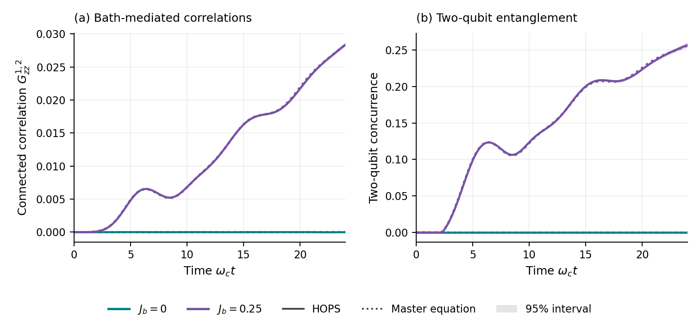
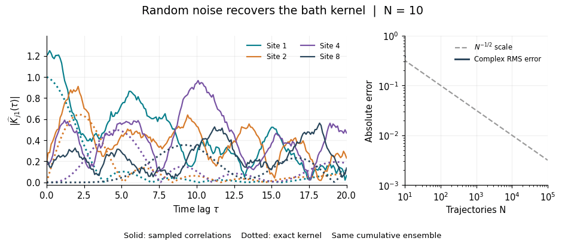
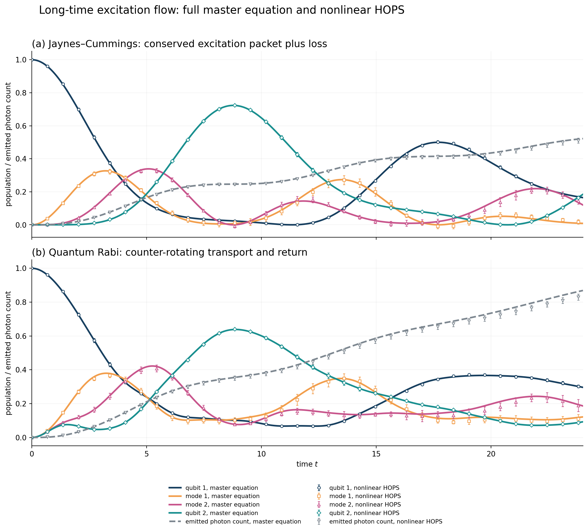

# Correlated HOPS

[](https://github.com/SFlann/correlated-hops/actions/workflows/tests.yml)

**Stochastic pure-state dynamics for systems coupled to communicating environments.**

A compact research companion to *Correlations carried and controlled by coupled
non-Markovian environments*, by Stuart Flannigan. The physical system is a set of
spins; local auxiliary hierarchies retain the memory and transport of eliminated
cavity modes.

Use it to explore how spins become correlated when their local environments
exchange excitations and retain memory. The package is designed as a small,
readable reference implementation with independent numerical checks.

The repository provides:

- A Python implementation of linear and normalised nonlinear HOPS for small systems.
- A Julia/ITensor MPS implementation of nonlinear HOPS for spin chains.
- A standalone correlated Gaussian-noise sampler and an animated convergence demo.
- A two-qubit excitation-transport study with a derivation, figures and numerical data.
- The numerical data behind the manuscript figures, including reference curves
  and the displayed uncertainty intervals.
- Short examples and tests against explicit-cavity master equations and across
  the two implementations.

The solvers use the **local bath basis**. Photon hopping enters both the coloured
noise and the hierarchy drift, including when neighbouring cavities have unequal
losses. No normal-mode approximation to the damping matrix is made.

## Python: two locally coupled spins

```sh
git clone https://github.com/SFlann/correlated-hops.git
cd correlated-hops
python -m venv .venv
source .venv/bin/activate
python -m pip install -e '.[plot,test]'
python examples/python/rabi_pair.py
pytest
```

Two initially uncorrelated spins develop correlations and entanglement through
their communicating environments, with no direct spin–spin interaction. Both
spins start down and the cavities start in vacuum. In units of
$\omega_c=1$, the spin frequency is $\omega_q=0.1$, local coupling is $g=0.3$,
and photon-number losses are $\kappa=(0.1,0.4)$. The interaction operators are
$F_i=g(S_i^-+0.25S_i^+)$. The calculation runs to $\omega_c t=24$, comparing
hopping $J_b=0.25$ with the uncoupled-bath control $J_b=0$.

The figure uses 4,096 trajectories per case. Solid curves are nonlinear HOPS,
shading is a pointwise 95% interval from resampling independent trajectory
batches, and dotted curves are independent finite-cutoff master equations.
Connected correlations and concurrence are formed from the ensemble density.
The script writes the plot, numerical arrays and a JSON record to
`examples/output/`. Add `--validate` to check nested-noise timestep refinement,
larger hierarchies and the reference's photon cutoff. See the
[numerical record](data/examples/package_pair/rabi_pair.json).



To replot the checked data without rerunning the ensemble:

```sh
python examples/python/rabi_pair.py --input-data data/examples/package_pair/rabi_pair.npz
```

A small exploratory run through the object API:

```python
import numpy as np
from correlated_hops import spin_chain, spin_operators

model = spin_chain(2, g=0.3, Jb=0.25, kappa=[0.1, 0.4])
result = model.solve(
    [1, 0, 0, 0],
    np.linspace(0, 1, 11),
    dt=0.01,
    kmax=[3, 4],
    samples=100,
    seed=17,
)
sz = spin_operators(2)["sz"]
correlation = result.connected(sz[0], sz[1]).real
entanglement = result.concurrence()
```

`kappa` is the photon-**number** loss rate; amplitude damping is `kappa/2`.
All energies are angular frequencies and hbar is one. Each `kmax` is an upper
hierarchy index, so the associated local dimension is `kmax + 1`.

## Correlated noise: watch the kernel emerge

Correlated Gaussian noise is a fundamental input to HOPS. Its covariance must
reproduce the environment's quantum correlation function: the noise at one
site and time is correlated with noise at another site and time when the bath
can carry excitations between them. These off-diagonal correlations are part
of the physical model, alongside the bath's temporal memory.

For a passive cavity network initially in vacuum, the required correlation is

$$
\begin{aligned}
\mathbb{E}\left[z_i(t)z_j^*(s)\right]
&=K_{ij}(t-s)=\left\langle a_i(t)a_j^\dagger(s)\right\rangle,\\
K(\tau)&=e^{-W\tau},\qquad
W=\operatorname{diag}(\kappa_i/2)+ih,\quad \tau=t-s\geq0.
\end{aligned}
$$

Here $h$ is the Hermitian bath hopping matrix and $\kappa_i$ is the
photon-number loss rate. The fields are zero-mean proper complex Gaussians,
with $\mathbb{E}[z_i(t)z_j(s)]=0$. For bath fields $B_i=g_i a_i$, the physical
correlation is $\alpha_{ij}(\tau)=g_i g_j^*K_{ij}(\tau)$. This package keeps
the coupling strengths in the system operators $F_i$ and samples the
unit-variance kernel $K$.

Although $K_{ij}(0)=\delta_{ij}$, hopping generally makes the off-diagonal
terms nonzero at finite lag. Independent site noises would miss these terms.
HOPS uses the same hopping and damping matrix in both the noise covariance
and the memory hierarchy. `Bath.sample` generates the required fields and can
also be used independently to inspect their statistics.



This noise-only example uses a **ten-mode open chain** with onsite frequency
$3$, nearest-neighbour hopping $0.5$, and uniform number loss $0.1$.
It samples the free bath without evolving any spins. Colours identify
correlations with site 1 at destinations 1, 2, 4 and 8. Each frame adds
trajectories to the same cumulative ensemble: the individual paths remain
random while their complex correlations converge. The displayed magnitude
is taken **after** averaging the complex products.

[Four-panel static version](docs/images/noise_convergence_panels.png) ·
[34-second video](docs/media/noise_convergence_original.mp4) ·
[Derivation, propagation plots and checks](docs/noise.md)

```python
import numpy as np
from correlated_hops import Bath

n = 10
h = 3 * np.eye(n) + 0.5 * (np.eye(n, k=1) + np.eye(n, k=-1))
bath = Bath(h, kappa=np.full(n, 0.1))
z = bath.sample(dt=0.1, steps=200, samples=2000, seed=17)
# Shape: (time, mode, independent trajectory)
sampled = (z * z[0, 0, :].conj()).mean(axis=-1)
exact = np.array([bath.kernel(t)[:, 0] for t in np.arange(201) * 0.1])
```

Run `python examples/python/noise_convergence.py` to generate the GIF, four-panel
figure, complex estimates and validation record. Sampling and rendering use the
standard plotting dependencies; no external video encoder is needed.

## Excitation transfer and return

The [two-qubit transport study](docs/two-qubit-note.md) follows an excitation
from the first qubit into its cavity, through the hopping link, into the
second qubit, and back again. This is a **resonant two-qubit model** with
$\omega_q=\omega_c=1$, $g=0.30$, $J_b=0.40$ and equal number losses
$\kappa_1=\kappa_2=0.10$. Initially qubit 1 is excited, qubit 2 is down,
and both cavities are in vacuum. There is no direct qubit–qubit interaction.

The Jaynes–Cummings (JC) interaction conserves excitation before loss; the
full-Rabi interaction also includes counter-rotating terms. Their different
transfer, return and entanglement dynamics are shown below. This model has
different frequencies, losses, preparation and couplings from the first
Python example; the ten-mode noise example above studies only the free bath.



The calculations use 4,096-trajectory nonlinear-HOPS ensembles with 95% batch
intervals and independent master-equation references. The
[derivation (PDF)](docs/studies/correlated_hops_note.pdf),
[JC–Rabi comparison](docs/images/note_jc_vs_rabi.png),
[photon observables](docs/images/note_photon_observables.png), and
[qubit–photon correlations](docs/images/note_system_mode_correlations.png)
are included with [numerical data and provenance](data/examples/README.md).
The study describes the normal-mode benchmark and its physical bath-observable
estimators, including how they differ from the local-basis `Result` API.

## Julia: tensor-network dynamics

```sh
julia --project=julia -e 'using Pkg; Pkg.instantiate(); Pkg.test()'
julia --project=julia examples/julia/spin_chain.jl
```

Julia uses an `Engine` object with ordinary multiple-dispatch methods such as
`simulate(engine, ...)`, `bath_kernel(engine, time)` and
`stationary_noise(engine, ...)`. The MPS alternates physical spins and local
hierarchy tensors. The example uses a short XXZ chain; changing the chain
length does not require constructing its dense Hilbert space. The integrator
applies four factorised polynomial MPOs after a midpoint predictor. See [the numerical conventions](docs/method.md)
for coefficient updates, truncation and observable estimation.

## Design

- **Dense Python baseline:** sparse hierarchy matrices and dense system vectors
  keep small-system calculations straightforward to inspect and validate.
- **Julia tensor representation:** separate spin and hierarchy tensors permit
  chain calculations without constructing the dense system Hilbert space.
- **Small object API:** `Bath.sample`, `Model.solve` and ensemble observables on
  `Result`, with equivalent functional entry points.
- **Independent checks:** explicit-cavity master equations test the numerical
  dynamics; prescribed-noise fixtures compare the two implementations.
- **Separate data archive:** examples write their own outputs. The manuscript
  inputs remain immutable and are checked against a SHA-256 manifest.

## Scope

The package implements time-independent spin Hamiltonians coupled to passive,
zero-temperature Gaussian cavity networks, with initially factorised vacuum
environments. Python accepts arbitrary finite system matrices. The Julia API
provides Rabi, transverse and longitudinal local couplings and XXZ interactions.

The manuscript's monitored-output and feedback figures are included as numerical
data. Feedback evolution is outside the solver API. Numerical settings in the
examples are validated for their stated models; other regimes require their
own convergence checks.

## Data and reproducibility

See the [API guide](docs/api.md), [data guide](data/README.md),
[validation](docs/validation.md), [contribution guidance](CONTRIBUTING.md) and
[release checks](docs/releasing.md). Figure data are kept separately from
solver examples: installing or testing the package never changes manuscript data.
Connected correlations and concurrence are evaluated from the **ensemble density**,
not by averaging their nonlinear values on individual stochastic states.

## Citation and licence

Use `CITATION.cff` to cite this software. Software is MIT licensed; numerical
data are CC BY 4.0. See `LICENSE` and `data/LICENSE`. Schematic artwork is not
part of the numerical-data release.
