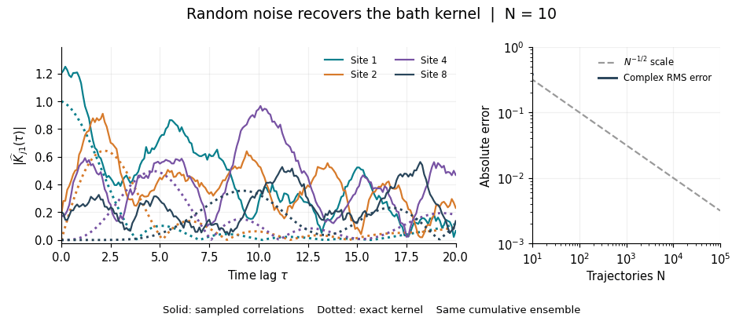
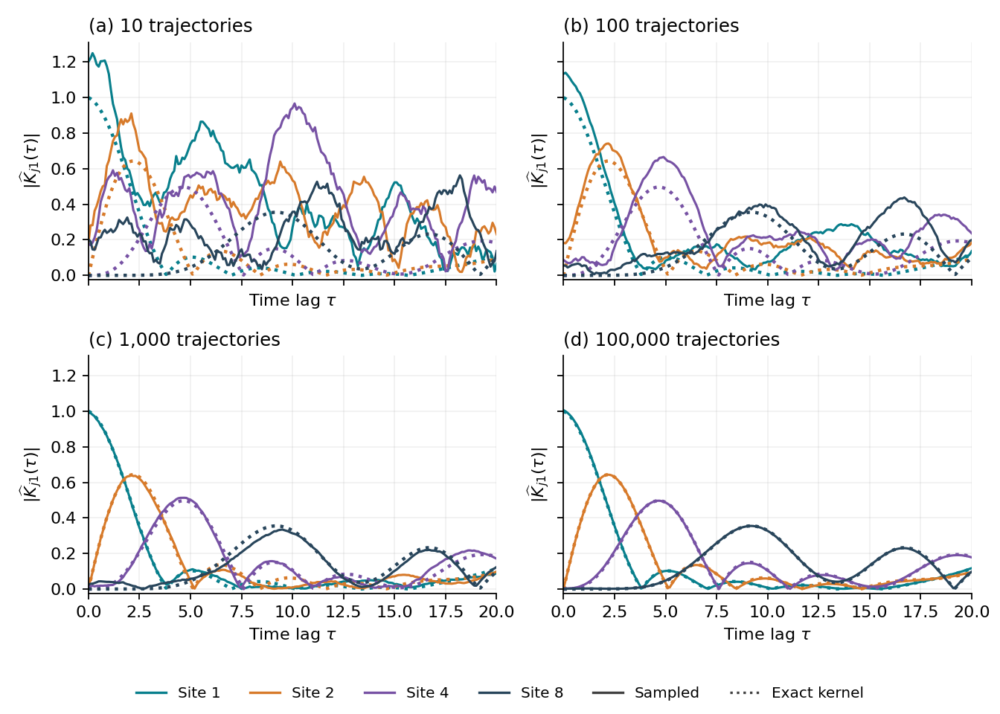
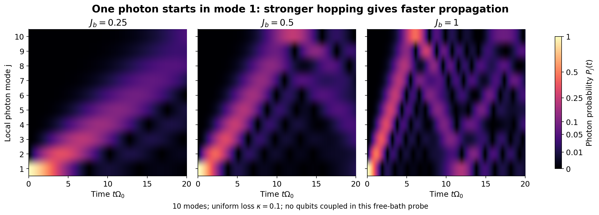

# Correlated Gaussian noise for HOPS

HOPS represents the environment's influence using complex Gaussian fields
and a hierarchy of memory states. The field covariance must equal the bath
correlation matrix. For communicating environments, off-diagonal entries
couple different sites at different times: reproducing each site's local
noise spectrum alone is insufficient. The same matrix enters the hierarchy
drift, so both parts of the calculation describe the same quantum bath.

`Bath` describes a passive Gaussian cavity network. Its `kernel(t)` and
`sample(...)` methods can be used without a spin model or a HOPS trajectory.
The solver uses this same sampler internally. The functional
`stationary_noise(bath, ...)` API is equivalent to `bath.sample(...)`.

```python
import numpy as np
from correlated_hops import Bath

n = 10
h = 3 * np.eye(n) + 0.5 * (np.eye(n, k=1) + np.eye(n, k=-1))
bath = Bath(h, kappa=np.full(n, 0.1))
z = bath.sample(dt=0.1, steps=200, samples=2000, seed=17)
# z has shape (time, mode, independent trajectory).
times = np.arange(201) * 0.1
sampled = (z * z[0, 0, :].conj()).mean(axis=-1)
exact = np.array([bath.kernel(t)[:, 0] for t in times])
```

Average the **complex products first**, then take their magnitude. Averaging
individual magnitudes discards phase cancellations and gives the wrong kernel.
Individual paths remain random as the estimated correlation converges.

## What is sampled

For the Hermitian hopping matrix $h$ and photon-number losses $\kappa_i$,
the vacuum bath correlation is

$$
K_{ij}(\tau)=\langle a_i(\tau)a_j^\dagger(0)\rangle
=\left[e^{-W\tau}\right]_{ij},\qquad
W=\mathrm{diag}(\kappa_i/2)+ih,\quad \tau\geq0.
$$

The reference Gaussian field satisfies

$$
\mathbb{E}[z(t)z(s)^\dagger]=K(t-s),\qquad
\mathbb{E}[z(t)z(s)^T]=0,\qquad \mathbb{E}[z(t)]=0
$$

for $t\geq s$, with $K(-\tau)=K(\tau)^\dagger$ for negative lags.
At equal times the covariance is the identity, but hopping generally produces
nonzero off-diagonal entries at finite lag. Sampling independent site noises,
or matching only the equal-time covariance, loses these correlations.
Coupling amplitudes such as $g$ belong to the system operators in `Model`, so they are not counted twice
in this kernel. For a physical field $B_i=g_i a_i$, multiply the corresponding
kernel entries by $g_i g_j^*$.

The exact discrete recursion is

$$
F=e^{-W\Delta t},\qquad BB^\dagger=I-FF^\dagger,\qquad
z_{k+1}=Fz_k+B\eta_k,
$$

with independent proper complex Gaussian innovations
$\eta_k=(X_k+iY_k)/\sqrt{2}$ and a stationary initial draw of unit covariance.
It preserves both temporal and spatial correlations, including unequal losses
that do not commute with hopping. With zero losses the innovations vanish
and only the propagated initial draw remains. This is exact sampling **on the
noise grid**; the HOPS dynamics still requires timestep and hierarchy checks.

## Watch the estimate converge



The ten-mode example uses $h_{ii}=3$, nearest-neighbour hopping $0.5$,
number loss $0.1$, and $\Delta t=0.1$ through $t=20$. Colours identify
destination sites 1, 2, 4 and 8, with site 1 as the origin. Every checkpoint
adds independent histories to the same cumulative ensemble. Solid curves are
sampled estimates; dotted curves are the exact kernel.



The four panels contain 10, 100, 1,000 and 100,000 trajectories. The final
complex RMS error is 0.00356 on the unit covariance scale. It is an absolute
error, not a uniform relative error along curves. The expected statistical
scale is $N^{-1/2}$; a particular sample need not improve monotonically.
The saved validation also checks complex covariances between five different
time origins, the zero mean and the pseudocovariance.

```sh
python examples/python/noise_convergence.py
# Render the saved package-example arrays again:
python examples/python/noise_convergence.py --input-data data/examples/package_noise/noise_convergence.npz
```

The default calculation samples 100,000 paths in bounded batches of 512 and
writes arrays, a JSON validation record, a GIF and the four-panel PNG to
`examples/output/`. The GIF requires no external video encoder.

The [34-second MP4](media/noise_convergence_original.mp4) shows a normal-mode
sampling calculation for the same ten-mode model with uniform damping. Its
[complex estimates](../data/examples/earlier_noise/noise_convergence.npz) and
[validation record](../data/examples/earlier_noise/validation.json) are included.
The GIF uses the public local-basis `Bath.sample` method. Both sample the same
physical covariance, with independently recorded batch and seed schemes;
they therefore use different random paths. Unequal losses are supported by
the local-basis sampler through the full matrix drift.

This example studies a free ten-mode bath. The two-qubit transport model
in the [excitation-transport guide](two-qubit-note.md) additionally couples
spins to two cavities, with different frequencies, hopping and preparation.

## Propagation behind the covariance



These reference panels show $|K_{j1}(t)|^2$ for a one-photon probe
in a ten-site open chain at three hopping strengths, with common colour and
time scales. Hopping transports the excitation; the finite chain produces
returns, and number loss damps the probability. The HOPS influence kernel is
computed for the vacuum bath. The injected photon is a visual probe of the
same propagator, not a change of the initial bath in the HOPS model.

The field construction is only part of correlated HOPS: the same hopping and
loss matrix also enters the hierarchy drift. Correlating the sampled noise
while leaving the hierarchy uncoupled would change the physical model. The
nonlinear solver additionally evolves the Girsanov shift; normalising a linear
trajectory alone does not implement nonlinear HOPS.

In Julia, `bath_kernel(engine, time)` exposes the same kernel, and
`stationary_noise(engine, dt, steps, seed)` returns one path shaped
`(modes, steps + 1)`. Julia and Python seeds do not generate identical paths;
use prescribed arrays for cross-language comparisons.
