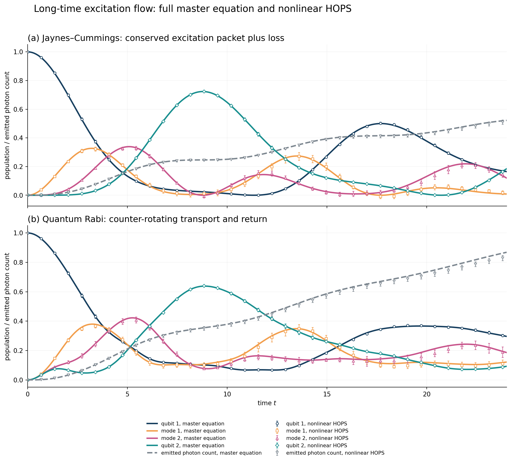
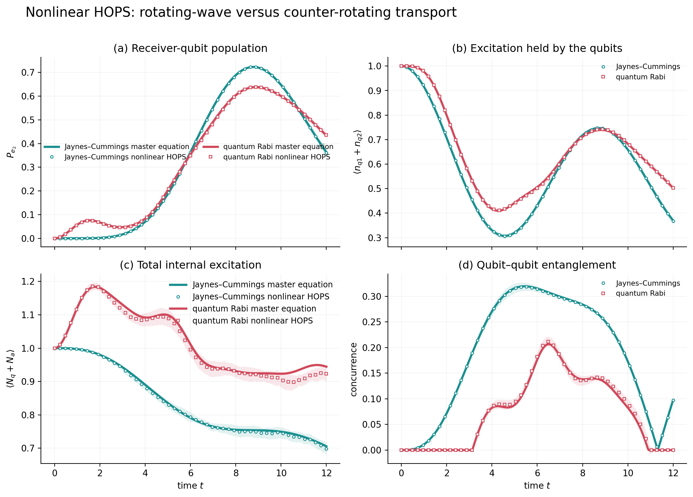
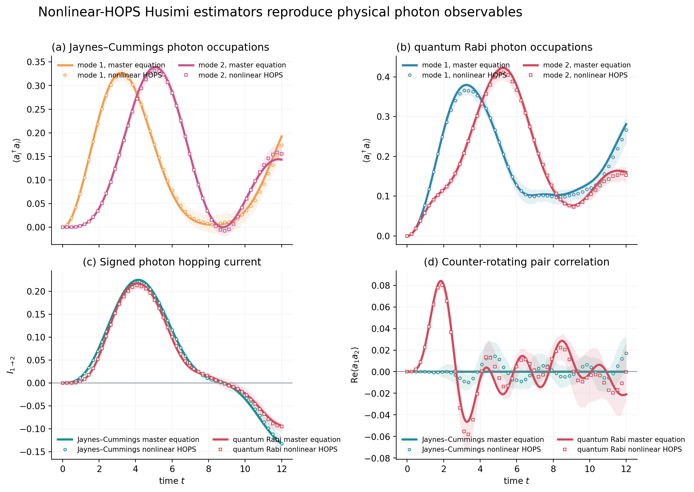
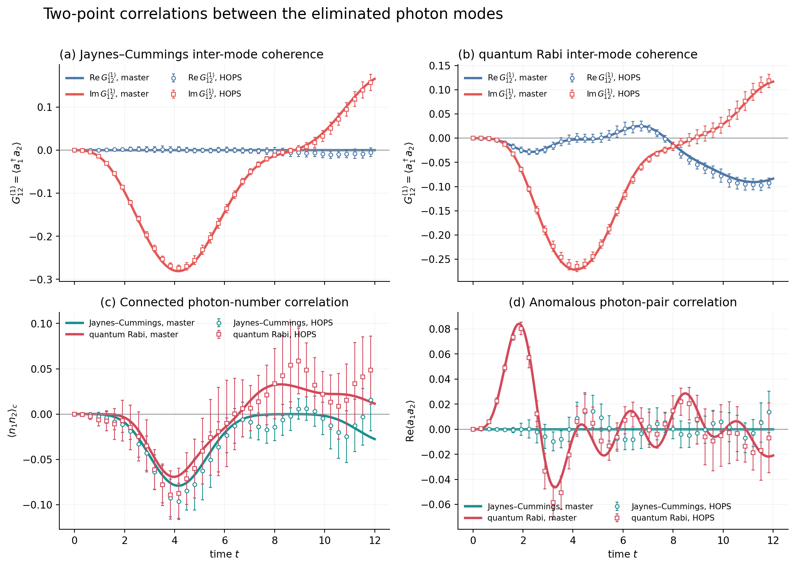
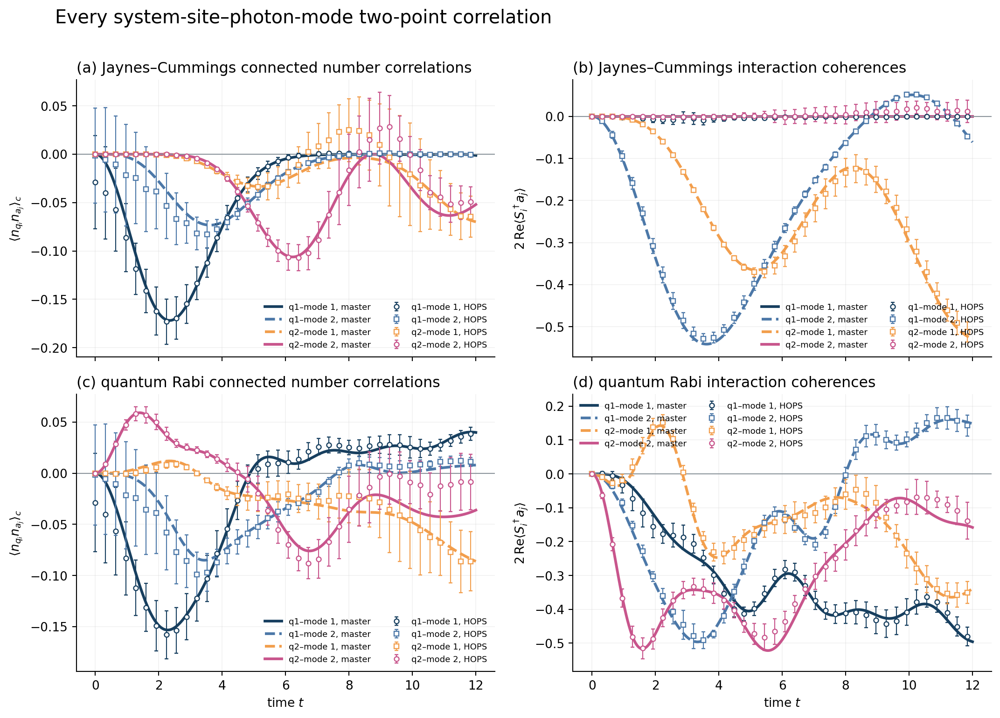

# The earlier two-qubit note

The [original note (PDF)](studies/correlated_hops_note.pdf) develops correlated
HOPS and illustrates excitation transport, return, counter-rotating processes,
and observables of the eliminated photon modes. Its figures and numerical
records are preserved here, with their original model and uncertainty estimates.

The two qubits have **no direct interaction**. Each couples to its own cavity;
photons hop between the cavities. Both start from qubit 1 excited, qubit 2 down,
and two vacuum modes. Parameters are $\omega_q=\omega_c=1$, $g=0.30$,
$J_b=0.40$ and equal photon-number loss $\kappa=0.10$.

JC uses $F_i=gS_i^-$; full Rabi uses $F_i=g(S_i^-+S_i^+)$.
In the current package these reduced-system models can be constructed with
`spin_chain(2, omega_spin=1, g=0.3, Jb=0.4, kappa=0.1,
counter_rotating=0)` and `counter_rotating=1`, respectively, and initial
state `[0, 0, 1, 0]`. They are separate parameter points from the first
README example, whose original parameters are preserved.

## Excitation leaves, arrives and returns

The upper panel is JC and the lower panel is full Rabi. The curves follow
qubit 1, cavity 1, cavity 2, qubit 2 and the cumulative emitted-photon count.
Lines are explicit-cavity master equations; markers and 95% intervals are
normalised nonlinear HOPS. The receiver reaches 0.7233 in JC and 0.6383 in
Rabi, and the sender later regains population. The emitted quantity is a
count in Rabi; it is a loss probability only in the one-excitation JC sector.

## What counter-rotating terms change

The four panels show (a) receiver population, (b) total excitation held by
the qubits, (c) total internal excitation of qubits and cavities, and
(d) qubit concurrence. They show observable changes
between the two specified Hamiltonians, rather than a numerical refinement
of one model. Maximum concurrence over this study's window falls from
approximately 0.3194 (JC) to 0.2065 (Rabi).

## Recovering observables of the eliminated modes

The populations track the two cavities, the signed hopping current reverses
during return, and the anomalous amplitude $|\langle a_1a_2\rangle|$ becomes
nonzero in Rabi. These physical photon observables were reconstructed using
the earlier solver's nonlinear Husimi-coordinate estimators. Auxiliary
hierarchy weights are **not** photon occupations.

The panels resolve normal coherence, connected photon-number correlations
and anomalous pair correlations. The photon-number estimators have visibly
larger sampling uncertainty.

The left column shows connected number correlations and the right column
interaction coherences for the local and nonlocal qubit–mode pairs.

## Numerical provenance and package scope

The original calculation used 4,096 antithetic trajectories in eight independent
batches, nonlinear HOPS timestep 0.02 and **total** hierarchy depth 7. Its
normal-mode solver differs from the companion package's local-basis solver;
a total depth is not the same as this package's per-mode `kmax`. Photon
reference dimensions were 2 per cavity for JC and 8 for Rabi. The saved
records contain the independent cutoff and hierarchy comparisons and the
measured runtimes.

- [Short-window arrays](../data/examples/earlier_note/dynamics.npz) and
  [numerical record](../data/examples/earlier_note/metrics.json).
- [Extended arrays](../data/examples/earlier_note/extended_dynamics.npz) and
  [long-time record](../data/examples/earlier_note/extended_metrics.json).
- [Asset manifest](../data/examples/manifest.json), including source paths and
  SHA-256 checksums of imported files.

These are archived results of the earlier research implementation. The current
`Result` API exposes reduced-system densities and observables; it does not yet
expose the earlier solver's photon or mixed system–photon estimators. The note
and archived results retain those additional demonstrations without presenting
them as outputs of the small package's current example script.
